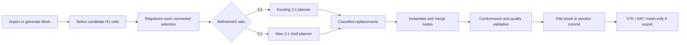

# Native H1 2:1 Refinement Design

Date: 2026-07-23

## Status

Approved for local implementation on `codex/h1-2to1-refinement`.

Development will remain local until the implementation, tests, browser workflow,
examples, and engineering validation are mature. Work will be split into
reviewable local commits. No remote branch or pull request will be created
during development.

## Context

HexRefine currently provides a native TypeScript workflow for conforming Q1 and
H1 local refinement. The H1 workflow uses a 3:1 refinement family:

- selected H1 parents are replaced by a 3 x 3 x 3 subdivision;
- neighboring parents receive face, edge, and corner transition templates;
- selection, regularization, preview, hierarchy, undo/redo, command replay, set
  remapping, and export are shared by the browser and offline workflows.

A separately developed Python prototype demonstrates conforming H1 2:1
refinement on structured and swept LS-DYNA meshes. It includes audited template
data, orientation handling, face-partition matching, transition planning,
conformance checks, and engineering validation on tensile, compression, and
double-shear specimens.

The prototype is a reference implementation and regression oracle. The upstream
contribution must be a native TypeScript implementation with no Python runtime
dependency.

## Goals

1. Add H1 2:1 refinement as a first-class alternative to the existing H1 3:1
   refinement.
2. Present 2:1 and 3:1 as equal, explicit choices in the public API, browser
   workbench, offline replay, and command scripts.
3. Reuse the existing selection methods:
   explicit element ids, coordinate boxes, signed-distance functions, screen
   rectangles, and named sets.
4. Reuse and extend the existing H1 selection regularization and support-shell
   preparation.
5. Support deterministic automatic transition-depth search, starting at two
   parent layers and selecting the shallowest conforming solution.
6. Support repeated 2:1 hierarchical refinement with preview, undo/redo,
   parent/child relationships, and set remapping.
7. Make 2:1 refinement available for every mesh import path supported by the
   shared `Mesh` representation.
8. Export 2:1 results through VTK, Abaqus INP, and a mesh-only LS-DYNA keyword
   writer.
9. Preserve all existing 3:1 and Q1 behavior by default.
10. Validate topology, conformance, orientation, and element quality before a
    refinement operation is committed to a session.

## Non-Goals

1. Q1 2:1 refinement is not part of this work.
2. This work will not create a CAD-to-hex automatic mesher.
3. The first implementation will not allow 2:1 and 3:1 to intersect within the
   same local hierarchy level.
4. The LS-DYNA writer will not preserve or remap a complete keyword deck.
5. Material, section, contact, boundary-condition, load, include, and database
   keywords are outside the LS-DYNA export scope.
6. Mixed-element meshes, higher-order input elements, and degenerate H1
   elements are outside the refinement scope.
7. The upstream contribution will not include private or large engineering
   model files.

## Compatibility Policy

The existing 3:1 path remains unchanged unless the caller explicitly selects
2:1.

New operations record the selected ratio explicitly. Existing API calls and
command scripts that omit a ratio continue to mean 3:1. This default exists
only for backward compatibility; the GUI presents 2:1 and 3:1 as equal choices.

The initial multi-level policy is:

- repeated 2:1 refinement is supported;
- repeated 3:1 refinement remains supported;
- a refinement operation may not use a different ratio on descendants in the
  same intersecting local hierarchy;
- disjoint regions may use different ratios when their refinement and
  transition domains do not intersect.

## Public API

Add a public ratio type:

```ts
export type HexRefinementRatio = 2 | 3;
```

Extend H1 refinement options without changing existing call sites:

```ts
export interface RefineOptions {
  // Existing fields remain unchanged.
  hexRefinementRatio?: HexRefinementRatio;
  maxTransitionLayers?: number;
  minimumScaledJacobian?: number;
  strictQuality?: boolean;
}
```

Semantics:

- `hexRefinementRatio` defaults to `3`.
- `maxTransitionLayers` applies to 2:1 and defaults to `6`.
- 2:1 planning starts at depth `2` and tests increasing depths.
- `minimumScaledJacobian` is a warning threshold by default.
- `strictQuality` promotes a threshold warning to an operation failure.
- a non-positive scaled Jacobian always fails.

The planner layer receives the ratio through `RefineOptions` and dispatches to
one of two native H1 strategies. Both strategies return the existing
`ClassifiedReplacement[]` contract so replacement, merging, hierarchy, and
export remain shared.

## Refinement Metadata

Keep the existing numeric `templateCode` for compact coloring and backward
compatibility. Add an optional stable string identifier:

```ts
export interface RefinementCellData {
  parentElementId: number;
  role: RefinementRole;
  templateCode: number;
  templateId?: string;
}
```

Reports and previews for H1 operations also record:

- selected ratio;
- requested and actual transition depth;
- regularized core element ids;
- transition parent ids by layer;
- template counts by stable template id;
- quality summary and warnings.

The string id distinguishes 2:1 templates that have similar child counts but
different face partitions or orientations.

## Shared Workflow

The end-to-end flow is:



Selection and regularization remain ratio-independent. A disconnected selection
is split into face-connected components and each component is regularized and
planned independently.

Selection regularization may perform the same documented completion or cropping
used by the current H1 workflow. The preview and report must expose every added
or removed core parent. Transition-depth search changes the support shell, not
the engineering core.

A model free boundary does not require a transition. Every internal core-to-
coarse interface must be closed by a conforming template field.

## Native 2:1 Template Library

The TypeScript implementation will port only independently verified H1 template
data from the Python reference. Each template contains:

- local reference coordinates;
- child H1 connectivity;
- a stable template id;
- the partition induced on each of the six parent faces;
- all proper cube orientations required to instantiate the template.

The selected-core template is the uniform 2 x 2 x 2 split.

Transition templates include the complete audited patterns needed to connect
fine, partially split, and coarse parent faces. Directional first- and
second-layer forms are represented as oriented instances of canonical
templates, not duplicated handwritten connectivity.

Template construction is deterministic. Every canonical template and every
proper orientation is validated before it is admitted to the runtime library.

## 2:1 Transition Planning

The TypeScript planner will use a topology-driven shell constraint model rather
than copying the prototype's specimen-specific selection scripts.

For each regularized core component:

1. Mark core parents with the uniform 1-to-8 template.
2. Build face incidence and discover candidate support shells up to
   `maxTransitionLayers`.
3. Start with a two-layer shell.
4. Build the allowed oriented-template candidates for every shell parent.
5. Constrain the inner shell boundary to match the fine partitions generated by
   the core.
6. Constrain the outer shell boundary to match unchanged coarse faces.
7. Constrain every shared shell face to have identical partitions from both
   owners.
8. Solve the finite template assignment deterministically.
9. If no assignment exists, add one parent layer and repeat.
10. Select the first valid depth and apply stable tie-breaking when multiple
    assignments exist.

Stable tie-breaking prefers:

1. fewer output H1 elements;
2. lower template complexity;
3. stable template id;
4. lower parent element id and orientation id.

This makes command replay and exported node/element numbering reproducible.

The planner reasons about all six faces of each parent simultaneously. It must
not assume that transition columns are independent, because shell fronts can
meet at edges and corners of a regularized three-dimensional core.

## Hierarchical Refinement

The 2:1 path uses the existing `RefinementSession` parent/child model.

Before refinement, the session verifies that:

- all selected cells are active;
- all selected cells are H1;
- selected cells belong to one active level per connected component;
- transition-role cells are not reused as a new refinement core;
- the requested ratio does not conflict with an intersecting ancestor or
  neighboring refinement domain.

The operation stores the ratio and transition metadata with its history record.
Undo and redo therefore restore the exact template field rather than rerunning
an unconstrained search.

Preview and execution use the same prepared selection and the same planner. A
preview must report the same parent roles, template ids, transition depth, and
estimated output count later used by execution.

## Import and Export

### Import

All supported input formats feed the same `Mesh` abstraction. H1 2:1 therefore
works after import from:

- HexRefine JSON;
- legacy ASCII VTK;
- supported ASCII VTU;
- supported Abaqus INP;
- supported LS-DYNA keyword mesh input.

Unsupported or mixed element types continue to be rejected by the importer.

### VTK and INP Export

The existing flat and native-session export paths remain shared. No
ratio-specific VTK or INP writer is required.

### Mesh-Only LS-DYNA Export

Add a streaming H1 writer with this scope:

```text
*KEYWORD
*NODE
...
*ELEMENT_SOLID
...
*END
```

The writer:

- accepts H1 only;
- accepts a positive integer PID option;
- emits stable, continuous node and element ids;
- writes eight-node solid connectivity;
- supports flat refined meshes and native-session exports;
- does not claim full keyword-deck round-trip behavior.

Re-importing the generated file must reproduce the same node coordinates,
element connectivity, and H1 topology.

## Browser, Offline Replay, and Commands

The browser workbench adds a compact H1 ratio selector with equal `2:1` and
`3:1` choices. The control affects preview and execution.

Command records include the ratio and 2:1 transition limit. Replaying a new
command must produce the same template assignment and numbering. Old command
records without a ratio retain 3:1 behavior.

The offline workflow and browser worker call the same exported TypeScript
planner. No browser-only template or planning logic is allowed.

The browser exposes:

- actual transition depth;
- core and transition parent counts;
- template counts;
- conformance status;
- minimum scaled Jacobian and quality warnings;
- structured failure diagnostics.

## Failure Model

A 2:1 operation is atomic. Planning, template instantiation, node merging,
conformance validation, and quality validation complete before a flat result is
returned or session history is mutated.

Planning failures use structured error data with stable codes. Diagnostics
include:

- original and regularized selections;
- attempted transition depths;
- conflicting parent ids, faces, and layers;
- insufficient support;
- overlapping disconnected transition domains;
- incompatible face partitions;
- unsupported hierarchy mixing;
- quality or orientation failures;
- corrective guidance where it is deterministic.

No partial mesh is returned as a successful result.

## Validation

Every completed 2:1 result is checked for:

- valid node references;
- eight distinct node ids per H1 element;
- no duplicate H1 connectivity;
- no non-manifold internal faces;
- identical partitions on every shared parent interface;
- no hanging nodes;
- no zero-volume or inverted elements;
- scaled Jacobian summary.

A scaled Jacobian at or below zero is always an error. A positive value below
the configured threshold is a warning unless strict quality mode is enabled.

## Test Strategy

### Template Tests

- child counts and connectivity;
- boundary face partitions;
- every proper cube orientation;
- deterministic orientation ids;
- no duplicate or inverted child H1 elements;
- positive reference scaled Jacobian;
- compatibility between all advertised face-partition pairs.

### Planner Tests

- explicit-id, box, SDF, screen-derived, and set-derived selections;
- internal cores and model-free-boundary cores;
- disconnected components;
- deformed structured blocks;
- folded but recoverable UVW blocks;
- cases whose shallowest solution is depth 2, 3, and 4;
- failure at a configured maximum depth;
- edge and corner meetings of transition fronts;
- deterministic plans and numbering.

### Session Tests

- repeated 2:1 hierarchy;
- undo and redo;
- stable cell and node set remapping;
- preview/execution identity;
- command replay identity;
- rejection of intersecting 2:1/3:1 hierarchy mixing;
- permitted disjoint operations;
- unchanged 3:1 and Q1 behavior.

### Import and Export Tests

The same small public H1 fixture is imported from JSON, VTK, VTU, INP, and K,
refined with the same 2:1 command, and compared topologically.

VTK, INP, and mesh-only K outputs are re-imported and checked for equivalent
coordinates and connectivity. K tests cover PID validation, stable numbering,
streamed output, and H1-only rejection.

### Engineering Acceptance

The local tensile, compression, and double-shear models remain private
acceptance fixtures. They are not committed upstream.

Each engineering model must pass:

- disk re-import;
- missing-reference audit;
- duplicate and non-manifold audit;
- hanging-node audit;
- inversion and scaled-Jacobian audit;
- deterministic rerun comparison;
- visual review in LS-PrePost.

## Maturity Gate

The implementation is mature enough for remote publication only when:

1. all existing tests remain green;
2. all new unit, planner, session, format, browser, and replay tests pass;
3. `npm run typecheck`, `npm test`, and `npm run pages:build` pass;
4. all three private engineering models pass the local acceptance suite;
5. no Python or external runtime dependency is required;
6. no known unsupported topology silently produces a mesh;
7. public APIs and command formats are documented;
8. performance and memory behavior are documented for large meshes;
9. generated examples can be reproduced from committed scripts;
10. the branch contains no private models or unrelated generated-file changes.

## Local Commit Plan

Development will use small, ordered local commits:

1. design specification;
2. ratio types, public options, and backward-compatibility tests;
3. canonical 2:1 template data, orientations, and template tests;
4. face-partition model and deterministic shell planner;
5. flat refinement, selection regularization, preview, and reports;
6. hierarchical session integration, undo/redo, sets, and command replay;
7. mesh-only LS-DYNA import/export parity and round-trip tests;
8. browser workbench, worker, and offline workflow integration;
9. public examples, documentation, performance work, and final regression
   hardening.

Each commit must build and pass the tests appropriate to its layer. The local
history may be amended or reorganized before publication, but the eventual pull
request should retain logically reviewable commits rather than one monolithic
change.

## Working Tree Isolation

The branch was created while five generated example files already had local
modifications. Those files are unrelated existing work and must not be staged
or included in 2:1 commits unless they are later regenerated intentionally as
part of an approved example update.

The Python prototype at
`D:\AI_Tools\HexRefine_lsdyna\hextransition2to1` remains a read-only reference
and local regression oracle during the TypeScript port.
